Mimiq sends a message for every trade it makes, for problems it finds, and for the traders you watch. You can switch the kinds on and off under `⚙️ Settings` → `🔔 Notifications`.

## Copy trading

Every card starts with the wallet it belongs to. A position that opens or closes shows the ticker, side, size, entry price and leverage.

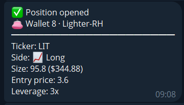

A close adds the exit price and a result block: realized PnL before and after fees, the fees, and the hold time.

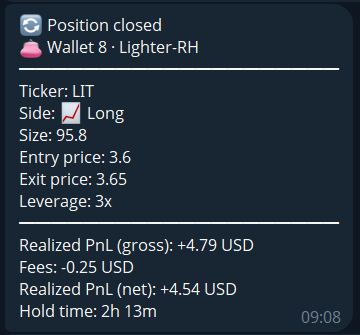

Numbers that the venue has not reported yet show as pending and are filled in when they arrive.

## Delta-Neutral

An opened pair lists both legs. The bot then asks whether to close the pair automatically if funding turns negative.

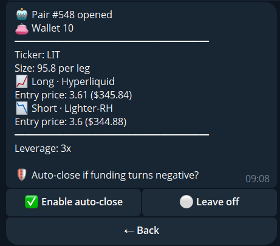

A closed pair shows both legs, the combined result, fees, funding and the hold time.

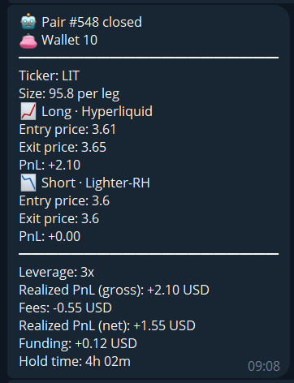

If one leg is closed on a venue, the hedge guard closes the other leg and tells you.

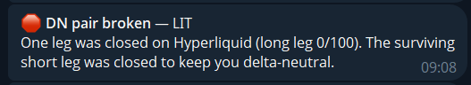

## Watch Traders

[Watch Traders](/guide/watch-traders/) alerts show the trader's name, what happened and the size. A closing fill is green with a profit and red with a loss. A canceled limit order is always red.

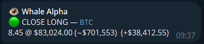

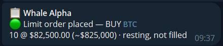

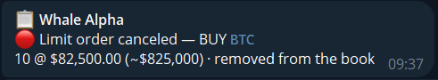

## When a key stops working

Mimiq checks your API keys regularly. If a venue no longer accepts one, you get a message with a button that opens the link flow for that venue and wallet. Open Delta-Neutral positions are not touched.

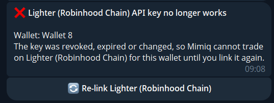

The positions screen says so too, instead of showing an empty list, and offers the same button.

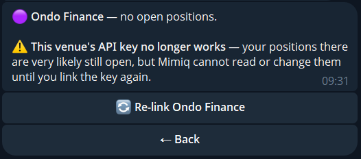

On **All linked platforms**, a venue that is only temporarily unreachable is listed separately from a venue whose key no longer works.

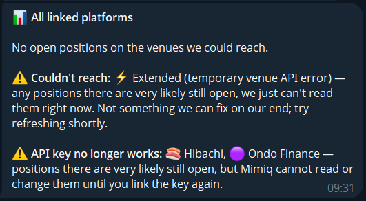
